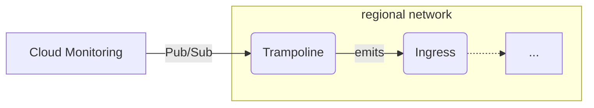

# `gcp-incident-events`

This module subscribes to the Pub/Sub topic of a Cloud Monitoring [Pub/Sub notification channel](https://docs.cloud.google.com/monitoring/support/notification-options) and publishes each incident notification to a broker.



Cloud Monitoring publishes a notification when an incident opens and again when it closes. Each one becomes a CloudEvent of type `dev.chainguard.gcp.monitoring.incident`. The module creates its own subscription on the topic, so any existing subscriber keeps receiving every message.

The event data is the notification body exactly as Cloud Monitoring published it ([schema](https://docs.cloud.google.com/monitoring/support/notification-options#schema-pubsub)), including the resource labels, metric labels and policy user labels. The event also carries these attributes for trigger filters:

| Attribute | Value |
| --------- | ----- |
| `id` | Pub/Sub message ID |
| `subject` | `incident.incident_id` |
| `state` | `incident.state`: `open` or `closed` |
| `project` | `incident.scoping_project_id` |
| `resourcetype` | `incident.resource.type` |
| `policyname` | `incident.policy_name` |
| `severity` | `incident.severity` |

The `recorder-schemas` output holds a BigQuery schema for `cloudevent-recorder`. Cloud Monitoring adds fields to the notification over time, so set `ignore_unknown_values = true` on the recorder to keep loads from failing on a field the schema doesn't list yet.

```hcl
// Create the Broker abstraction.
module "cloudevent-broker" {
  source = "chainguard-dev/common/infra//modules/cloudevent-broker"

  name       = "my-broker"
  project_id = var.project_id
  regions    = module.networking.regional-networks
}

// The topic a Cloud Monitoring notification channel publishes to.
resource "google_pubsub_topic" "alerts" {
  name = "alerts"
}

resource "google_monitoring_notification_channel" "pubsub" {
  display_name = "pubsub alerts"
  type         = "pubsub"
  labels = {
    topic = google_pubsub_topic.alerts.id
  }
}

data "google_project" "project" {
  project_id = var.project_id
}

// Without this grant, Cloud Monitoring can't publish to the topic and the
// module never receives an incident.
resource "google_pubsub_topic_iam_member" "monitoring-publishes-alerts" {
  topic  = google_pubsub_topic.alerts.name
  role   = "roles/pubsub.publisher"
  member = "serviceAccount:service-${data.google_project.project.number}@gcp-sa-monitoring-notification.iam.gserviceaccount.com"
}

// Forward incidents to the broker.
module "gcp-incident-events" {
  source = "chainguard-dev/common/infra//modules/gcp-incident-events"

  project_id = var.project_id
  name       = "incident-events"
  topic      = google_pubsub_topic.alerts.id
  region     = "us-central1"
  regions    = module.networking.regional-networks
  ingress    = module.cloudevent-broker.ingress
  team       = "my-team"

  notification_channels = [...]
}
```

<!-- BEGIN_TF_DOCS -->
## Requirements

No requirements.

## Providers

| Name | Version |
| ---- | ------- |
| <a name="provider_google"></a> [google](#provider\_google) | n/a |
| <a name="provider_google-beta"></a> [google-beta](#provider\_google-beta) | n/a |
| <a name="provider_random"></a> [random](#provider\_random) | n/a |

## Modules

| Name | Source | Version |
| ---- | ------ | ------- |
| <a name="module_authorize-delivery"></a> [authorize-delivery](#module\_authorize-delivery) | ../authorize-private-service | n/a |
| <a name="module_dashboard"></a> [dashboard](#module\_dashboard) | ../dashboard | n/a |
| <a name="module_http"></a> [http](#module\_http) | ../dashboard/sections/http | n/a |
| <a name="module_layout"></a> [layout](#module\_layout) | ../dashboard/sections/layout | n/a |
| <a name="module_logs"></a> [logs](#module\_logs) | ../dashboard/sections/logs | n/a |
| <a name="module_resources"></a> [resources](#module\_resources) | ../dashboard/sections/resources | n/a |
| <a name="module_this"></a> [this](#module\_this) | ../regional-go-service | n/a |
| <a name="module_topic"></a> [topic](#module\_topic) | ../dashboard/sections/topic | n/a |
| <a name="module_trampoline-emits-events"></a> [trampoline-emits-events](#module\_trampoline-emits-events) | ../authorize-private-service | n/a |
| <a name="module_width"></a> [width](#module\_width) | ../dashboard/sections/width | n/a |

## Resources

| Name | Type |
| ---- | ---- |
| [google-beta_google_project_service_identity.pubsub](https://registry.terraform.io/providers/hashicorp/google-beta/latest/docs/resources/google_project_service_identity) | resource |
| [google_pubsub_subscription.dead-letter-pull-sub](https://registry.terraform.io/providers/hashicorp/google/latest/docs/resources/pubsub_subscription) | resource |
| [google_pubsub_subscription.this](https://registry.terraform.io/providers/hashicorp/google/latest/docs/resources/pubsub_subscription) | resource |
| [google_pubsub_subscription_iam_binding.allow-pubsub-to-ack](https://registry.terraform.io/providers/hashicorp/google/latest/docs/resources/pubsub_subscription_iam_binding) | resource |
| [google_pubsub_topic.dead-letter](https://registry.terraform.io/providers/hashicorp/google/latest/docs/resources/pubsub_topic) | resource |
| [google_pubsub_topic_iam_binding.allow-pubsub-to-send-to-dead-letter](https://registry.terraform.io/providers/hashicorp/google/latest/docs/resources/pubsub_topic_iam_binding) | resource |
| [google_service_account.delivery](https://registry.terraform.io/providers/hashicorp/google/latest/docs/resources/service_account) | resource |
| [google_service_account.service](https://registry.terraform.io/providers/hashicorp/google/latest/docs/resources/service_account) | resource |
| [google_service_account_iam_binding.allow-pubsub-to-mint-tokens](https://registry.terraform.io/providers/hashicorp/google/latest/docs/resources/service_account_iam_binding) | resource |
| [google_tags_tag_binding.dead_letter_subscription](https://registry.terraform.io/providers/hashicorp/google/latest/docs/resources/tags_tag_binding) | resource |
| [google_tags_tag_binding.dead_letter_topic](https://registry.terraform.io/providers/hashicorp/google/latest/docs/resources/tags_tag_binding) | resource |
| [google_tags_tag_binding.subscription](https://registry.terraform.io/providers/hashicorp/google/latest/docs/resources/tags_tag_binding) | resource |
| [random_string.delivery-suffix](https://registry.terraform.io/providers/hashicorp/random/latest/docs/resources/string) | resource |
| [random_string.service-suffix](https://registry.terraform.io/providers/hashicorp/random/latest/docs/resources/string) | resource |
| [google_project.resource_manager_tags](https://registry.terraform.io/providers/hashicorp/google/latest/docs/data-sources/project) | data source |

## Inputs

| Name | Description | Type | Default | Required |
| ---- | ----------- | ---- | ------- | :------: |
| <a name="input_deletion_protection"></a> [deletion\_protection](#input\_deletion\_protection) | Whether to enable delete protection for the service. | `bool` | `true` | no |
| <a name="input_enable_profiler"></a> [enable\_profiler](#input\_enable\_profiler) | Enable cloud profiler. | `bool` | `false` | no |
| <a name="input_ingress"></a> [ingress](#input\_ingress) | An object holding the name of the ingress service, which can be used to authorize callers to publish cloud events. | <pre>object({<br/>    name = string<br/>  })</pre> | n/a | yes |
| <a name="input_labels"></a> [labels](#input\_labels) | Labels to apply to the incident event resources. | `map(string)` | `{}` | no |
| <a name="input_max_delivery_attempts"></a> [max\_delivery\_attempts](#input\_max\_delivery\_attempts) | The maximum number of delivery attempts for any notification before it is dead-lettered. | `number` | `5` | no |
| <a name="input_name"></a> [name](#input\_name) | n/a | `string` | n/a | yes |
| <a name="input_notification_channels"></a> [notification\_channels](#input\_notification\_channels) | List of notification channels to alert. | `list(string)` | n/a | yes |
| <a name="input_observability_role"></a> [observability\_role](#input\_observability\_role) | Fully-qualified id of a single role (e.g. from the observability-role module) to grant the service account in place of the three built-in observability roles (monitoring.metricWriter, cloudtrace.agent, cloudprofiler.agent). Collapsing to one role keeps large projects under the 1,500-member IAM policy limit. | `string` | `null` | no |
| <a name="input_product"></a> [product](#input\_product) | Product label to apply to the service. | `string` | `""` | no |
| <a name="input_project_id"></a> [project\_id](#input\_project\_id) | n/a | `string` | n/a | yes |
| <a name="input_region"></a> [region](#input\_region) | The region to run the trampoline service in. Must be a key of the regions variable. | `string` | n/a | yes |
| <a name="input_regions"></a> [regions](#input\_regions) | A map from region names to a network and subnetwork. Only the entry for the region variable is used. | <pre>map(object({<br/>    network = string<br/>    subnet  = string<br/>  }))</pre> | n/a | yes |
| <a name="input_resource_manager_tags"></a> [resource\_manager\_tags](#input\_resource\_manager\_tags) | Resource Manager tags to bind to this module's Pub/Sub resources, as tagKeys/<id> => tagValues/<id>. | `map(string)` | `{}` | no |
| <a name="input_team"></a> [team](#input\_team) | Team label to apply to resources. | `string` | n/a | yes |
| <a name="input_topic"></a> [topic](#input\_topic) | The ID (projects/<project>/topics/<topic>) of the Pub/Sub topic that a Cloud Monitoring pubsub notification channel publishes incidents to. The module creates its own subscription on it, so existing subscribers are unaffected. | `string` | n/a | yes |

## Outputs

| Name | Description |
| ---- | ----------- |
| <a name="output_recorder-schemas"></a> [recorder-schemas](#output\_recorder-schemas) | n/a |
<!-- END_TF_DOCS -->
